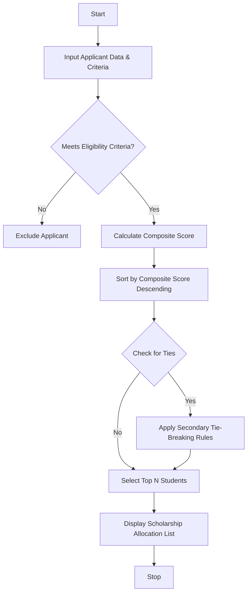

## Problem Statement

Design an automated scholarship allocation system for a university that evaluates student applicants based on multiple criteria: aggregate marks, subject-wise minimum scores, attendance percentage, and family annual income. The system must filter out ineligible students, calculate a composite ranking score for eligible candidates, resolve ties using predefined tie-breaking rules, and allocate scholarships up to a fixed number of available slots.

---

## Algorithm

1. **Initialize Data:** Input the list of student applicants along with university criteria thresholds (minimum aggregate marks, minimum subject marks, minimum attendance, maximum income) and available scholarship slots.
2. **Eligibility Check:** For each applicant, verify if:
* Aggregate marks $\ge$ Threshold
* All individual subject marks $\ge$ Minimum requirement
* Attendance percentage $\ge$ Threshold
* Annual family income $\le$ Maximum threshold


3. **Filter & Score:** Retain only the eligible applicants and compute a composite score using weighted metrics (e.g., $60\%$ aggregate marks $+ 40\%$ attendance).
4. **Sort & Resolve Ties:** Sort the eligible applicants in descending order of their composite score. If scores are identical, apply tie-breaking rules sequentially: higher aggregate marks, higher attendance, and lower family income.
5. **Allocate Scholarships:** Select the top $N$ candidates corresponding to the available scholarship slots.
6. **Output:** Display the final allocated list of scholarship recipients.

---

## Flowchart



---

## Python Source Code

```python
def evaluate_and_allocate(applicants, available_slots):
  eligible = []
  for app in applicants:
    if (
        app['aggregate'] >= 75
        and app['attendance'] >= 85
        and app['income'] <= 50000
        and all(m >= 60 for m in app['subjects'])
    ):
      score = (app['aggregate'] * 0.6) + (app['attendance'] * 0.4)
      app['score'] = score
      eligible.append(app)

  eligible.sort(
      key=lambda x: (x['score'], x['aggregate'], x['attendance'], -x['income']),
      reverse=True,
  )

  allocated = eligible[:available_slots]
  return allocated


applicants_data = [
    {
        'id': 1,
        'name': 'Alice',
        'aggregate': 88,
        'subjects': [70, 85, 90],
        'attendance': 90,
        'income': 40000,
    },
    {
        'id': 2,
        'name': 'Bob',
        'aggregate': 92,
        'subjects': [80, 85, 95],
        'attendance': 95,
        'income': 45000,
    },
    {
        'id': 3,
        'name': 'Charlie',
        'aggregate': 88,
        'subjects': [75, 80, 85],
        'attendance': 92,
        'income': 35000,
    },
    {
        'id': 4,
        'name': 'Diana',
        'aggregate': 70,
        'subjects': [65, 70, 60],
        'attendance': 80,
        'income': 30000,
    },
]

result = evaluate_and_allocate(applicants_data, 2)
for r in result:
  print(f"ID: {r['id']}, Name: {r['name']}, Score: {r['score']:.2f}")

```

---

## Sample Input

* **Available Scholarship Slots:** `2`
* **Eligibility Criteria Thresholds:**
* Minimum Aggregate Marks: `75%`
* Minimum Subject-wise Marks: `60%`
* Minimum Attendance: `85%`
* Maximum Family Income: `50,000`


* **Applicants Dataset:**
* **Alice:** Aggregate: 88, Subjects: [70, 85, 90], Attendance: 90%, Income: 40,000
* **Bob:** Aggregate: 92, Subjects: [80, 85, 95], Attendance: 95%, Income: 45,000
* **Charlie:** Aggregate: 88, Subjects: [75, 80, 85], Attendance: 92%, Income: 35,000 *(Diana excluded due to low aggregate and attendance)*


---

## Sample Output

```text
ID: 2, Name: Bob, Score: 93.20
ID: 3, Name: Charlie, Score: 89.60

```
