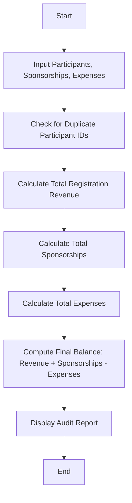

## Problem Statement

A university is hosting an annual campus festival and requires an automated audit system. The system needs to process a list of participant registrations while detecting and removing duplicate entries based on participant IDs. It must then calculate the total registration revenue, add all sponsorship contributions, subtract total festival expenses, and compute the final financial balance.

---

## Algorithm

1. **Initialize Data**: Define lists/dictionaries containing participant registration records, sponsorship contributions, and festival expenses.
2. **Detect Duplicates**: Iterate through the participant list using a dictionary or tracking set keyed by participant ID. If an ID already exists, increment the duplicate counter and skip adding it to the unique participants list.
3. **Calculate Registration Revenue**: Sum the registration fees of all unique participants.
4. **Calculate Total Sponsorships**: Sum the monetary amounts from all sponsorship contributions.
5. **Calculate Total Expenses**: Sum the monetary amounts of all recorded festival expenses.
6. **Compute Final Balance**: Calculate the net balance using the formula: $\text{Net Balance} = (\text{Registration Revenue} + \text{Total Sponsorships}) - \text{Total Expenses}$.
7. **Output Report**: Display the total unique participants, duplicate count, total revenue, total sponsorships, total expenses, and final financial balance.

---

## Flowchart



---

## Python Source Code

```python
def audit_festival(participants_data, sponsorships, expenses):
    unique_participants = {}
    duplicates = 0
    
    for p in participants_data:
        pid = p["id"]
        if pid in unique_participants:
            duplicates += 1
        else:
            unique_participants[pid] = p
            
    total_reg_revenue = sum(p["fee"] for p in unique_participants.values())
    total_sponsorship = sum(s["amount"] for s in sponsorships)
    total_expenses = sum(e["amount"] for e in expenses)
    
    net_balance = (total_reg_revenue + total_sponsorship) - total_expenses
    
    return {
        "total_unique_participants": len(unique_participants),
        "duplicate_registrations": duplicates,
        "total_registration_revenue": total_reg_revenue,
        "total_sponsorship": total_sponsorship,
        "total_expenses": total_expenses,
        "final_balance": net_balance
    }

if __name__ == "__main__":
    participants = [
        {"id": "P001", "name": "Alice", "fee": 500},
        {"id": "P002", "name": "Bob", "fee": 500},
        {"id": "P001", "name": "Alice", "fee": 500},
        {"id": "P003", "name": "Charlie", "fee": 600}
    ]
    
    sponsorships = [
        {"sponsor": "TechCorp", "amount": 15000},
        {"sponsor": "LocalCafe", "amount": 5000}
    ]
    
    expenses = [
        {"item": "Stage Setup", "amount": 6000},
        {"item": "Sound System", "amount": 4000}
    ]
    
    result = audit_festival(participants, sponsorships, expenses)
    for key, value in result.items():
        print(f"{key}: {value}")

```

---

## Sample Input

* **Participants:**
* `{'id': 'P001', 'name': 'Alice', 'fee': 500}`
* `{'id': 'P002', 'name': 'Bob', 'fee': 500}`
* `{'id': 'P001', 'name': 'Alice', 'fee': 500}` (Duplicate)
* `{'id': 'P003', 'name': 'Charlie', 'fee': 600}`


* **Sponsorships:**
* `{'sponsor': 'TechCorp', 'amount': 15000}`
* `{'sponsor': 'LocalCafe', 'amount': 5000}`


* **Expenses:**
* `{'item': 'Stage Setup', 'amount': 6000}`
* `{'item': 'Sound System', 'amount': 4000}`


---

## Sample Output

```text
total_unique_participants: 3
duplicate_registrations: 1
total_registration_revenue: 1600
total_sponsorship: 20000
total_expenses: 10000
final_balance: 11600

```
