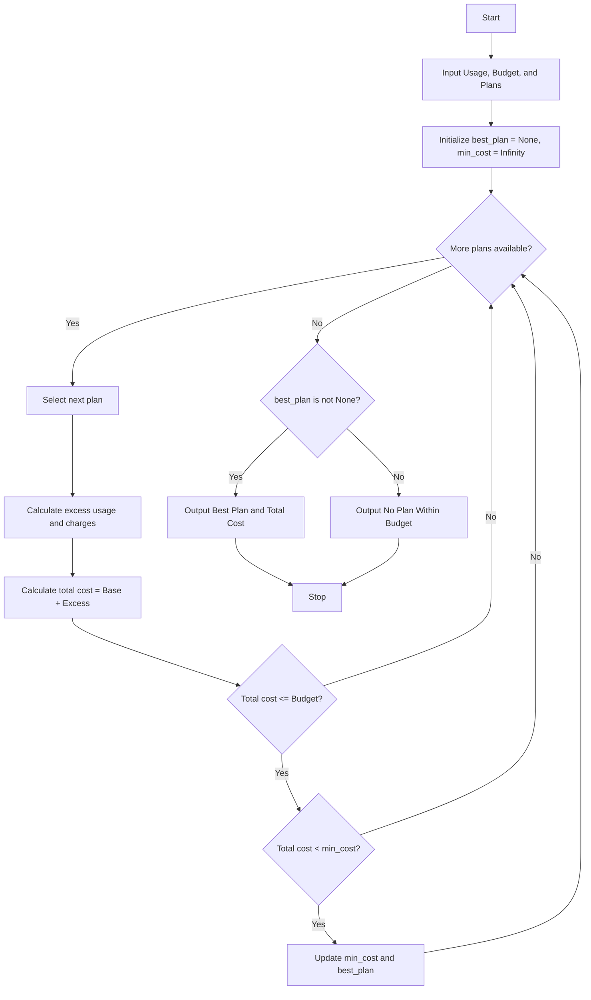

## Problem Statement

Design a program to evaluate multiple telecommunications mobile plans against a user's specific monthly usage (voice minutes, data in GB, SMS count), budget constraints, and validity requirements. The program must calculate any excess charges if usage exceeds the plan's included limits, determine the total cost for each eligible plan, and identify the most economical plan that fits within the user's budget.

---

## Algorithm

1. **Start** the program.
2. **Input** user requirements: required voice minutes, data usage, SMS count, and maximum budget.
3. **Input** the list of available mobile plans, where each plan contains:
* Plan Name
* Base Price
* Included Minutes, Data, and SMS
* Excess Rates per Minute, GB, and SMS
* Validity (in days)


4. **Initialize** `best_plan = None` and `min_cost = Infinity`.
5. **Iterate** through each plan in the list:
* Calculate excess minutes: `max(0, user_minutes - included_minutes)`
* Calculate excess data: `max(0, user_data - included_data)`
* Calculate excess SMS: `max(0, user_sms - included_sms)`
* Calculate excess charges: `(excess_minutes * rate_minute) + (excess_data * rate_data) + (excess_sms * rate_sms)`
* Calculate total cost: `base_price + excess_charges`
* Check if total cost is less than or equal to `max_budget` AND less than `min_cost`.
* If true, update `min_cost = total_cost` and `best_plan = current_plan`.


6. **Display** the optimal plan and its total cost if found; otherwise, display that no eligible plan exists within the budget.
7. **Stop**.

---

## Flowchart



---

## Python Source Code

```python
def calculate_cost(plan, usage):
    base = plan["base_price"]
    
    excess_min = max(0, usage["minutes"] - plan["inc_minutes"])
    excess_data = max(0, usage["data"] - plan["inc_data"])
    excess_sms = max(0, usage["sms"] - plan["inc_sms"])
    
    excess_charges = (
        excess_min * plan["rate_min"] +
        excess_data * plan["rate_data"] +
        excess_sms * plan["rate_sms"]
    )
    
    return base + excess_charges

def find_best_plan(plans, usage, budget):
    best_plan = None
    min_cost = float("inf")
    
    for plan in plans:
        total_cost = calculate_cost(plan, usage)
        if total_cost <= budget and total_cost < min_cost:
            min_cost = total_cost
            best_plan = plan
            
    return best_plan, min_cost

if __name__ == "__main__":
    user_usage = {
        "minutes": 350,
        "data": 12.5,
        "sms": 100
    }
    max_budget = 600.0
    
    available_plans = [
        {
            "name": "Plan A",
            "base_price": 300.0,
            "inc_minutes": 300,
            "inc_data": 10.0,
            "inc_sms": 50,
            "rate_min": 1.5,
            "rate_data": 15.0,
            "rate_sms": 0.5
        },
        {
            "name": "Plan B",
            "base_price": 500.0,
            "inc_minutes": 500,
            "inc_data": 20.0,
            "inc_sms": 200,
            "rate_min": 1.0,
            "rate_data": 10.0,
            "rate_sms": 0.2
        },
        {
            "name": "Plan C",
            "base_price": 400.0,
            "inc_minutes": 400,
            "inc_data": 15.0,
            "inc_sms": 100,
            "rate_min": 1.2,
            "rate_data": 12.0,
            "rate_sms": 0.4
        }
    ]
    
    best, cost = find_best_plan(available_plans, user_usage, max_budget)
    
    if best:
        print(f"Optimal Plan: {best['name']}")
        print(f"Total Cost: {cost}")
    else:
        print("No eligible plan found within the budget.")

```

---

## Sample Input

* **User Usage:**
* Minutes: 350
* Data: 12.5 GB
* SMS: 100


* **Maximum Budget:** 600.0
* **Available Plans:**
* **Plan A:** Base = 300.0 | Inc: 300 mins, 10 GB, 50 SMS | Rates: 1.5/min, 15.0/GB, 0.5/SMS
* **Plan B:** Base = 500.0 | Inc: 500 mins, 20 GB, 200 SMS | Rates: 1.0/min, 10.0/GB, 0.2/SMS
* **Plan C:** Base = 400.0 | Inc: 400 mins, 15 GB, 100 SMS | Rates: 1.2/min, 12.0/GB, 0.4/SMS


---

## Sample Output

```text
Optimal Plan: Plan C
Total Cost: 400.0

```
