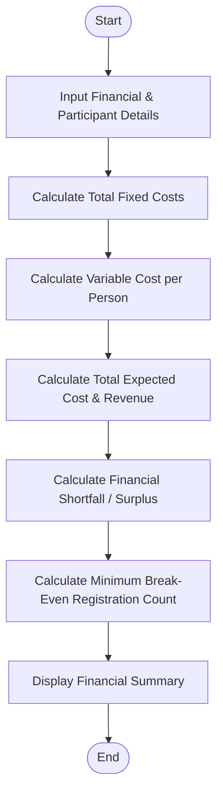

Here is the complete solution for the Campus Event Financial Planning problem, structured with the problem statement, algorithm, Mermaid flowchart, Python source code (without comments), and sample input/output.

---

### ## Problem Statement

Develop a Python program to perform financial planning for a campus event. The program must compute fixed costs (venue, equipment, transport), variable costs (catering, certificates per participant), total expected costs, total expected revenue (from participant contributions and sponsorships), potential shortfalls or surpluses, and determine the minimum number of registrations required to break even.

---

### ## Algorithm

1. **Input Financial Parameters:** Read venue cost, equipment cost, transport cost, catering cost per person, certificate cost per person, registration fee per participant, total sponsorship amount, and expected participant count.
2. **Calculate Fixed Costs:** Sum venue cost, equipment cost, and transport cost.
3. **Calculate Variable Costs:** Sum catering cost per person and certificate cost per person.
4. **Calculate Total Expected Cost:** Add fixed costs to the product of variable cost per person and expected participants.
5. **Calculate Total Expected Revenue:** Add total sponsorship to the product of registration fee per participant and expected participants.
6. **Determine Shortfall/Surplus:** Subtract total expected revenue from total expected cost.
7. **Calculate Break-Even Count:** Compute the minimum participants needed using the formula:

$$\text{Minimum Registrations} = \left\lceil \frac{\text{Total Fixed Costs} - \text{Total Sponsorship}}{\text{Registration Fee} - \text{Variable Cost per Person}} \right\rceil$$


8. **Display Results:** Output the financial summary, including costs, revenue, shortfall/surplus, and the break-even registration count.

---

### ## Flowchart



---

### ## Python Source Code

```python
import math

def main():
    venue_cost = float(input("Enter venue cost: "))
    equipment_cost = float(input("Enter equipment cost: "))
    transport_cost = float(input("Enter transport cost: "))
    catering_per_person = float(input("Enter catering cost per person: "))
    certificate_per_person = float(input("Enter certificate cost per person: "))
    fee_per_person = float(input("Enter participant contribution per person: "))
    total_sponsorship = float(input("Enter total sponsorship amount: "))
    expected_participants = int(input("Enter expected number of participants: "))

    total_fixed_cost = venue_cost + equipment_cost + transport_cost
    variable_cost_per_person = catering_per_person + certificate_per_person
    
    total_cost = total_fixed_cost + (variable_cost_per_person * expected_participants)
    total_revenue = (fee_per_person * expected_participants) + total_sponsorship
    
    shortfall = total_cost - total_revenue
    
    net_contribution_per_person = fee_per_person - variable_cost_per_person
    if net_contribution_per_person > 0:
        numerator = total_fixed_cost - total_sponsorship
        min_break_even = math.ceil(numerator / net_contribution_per_person)
        if min_break_even < 0:
            min_break_even = 0
    else:
        min_break_even = "Infinity (Contribution does not cover variable costs)"

    print("\n--- Event Financial Summary ---")
    print(f"Total Fixed Cost: ${total_fixed_cost:.2f}")
    print(f"Variable Cost Per Person: ${variable_cost_per_person:.2f}")
    print(f"Total Expected Cost: ${total_cost:.2f}")
    print(f"Total Expected Revenue: ${total_revenue:.2f}")
    if shortfall > 0:
        print(f"Financial Shortfall: ${shortfall:.2f}")
    else:
        print(f"Financial Surplus: ${abs(shortfall):.2f}")
    print(f"Minimum Break-Even Registration Count: {min_break_even}")

if __name__ == "__main__":
    main()

```

---

### ## Sample Input

```text
Enter venue cost: 5000
Enter equipment cost: 1200
Enter transport cost: 800
Enter catering cost per person: 150
Enter certificate cost per person: 50
Enter participant contribution per person: 300
Enter total sponsorship amount: 2000
Enter expected number of participants: 40

```

---

### ## Sample Output

```text
--- Event Financial Summary ---
Total Fixed Cost: $7000.00
Variable Cost Per Person: $200.00
Total Expected Cost: $15000.00
Total Expected Revenue: $14000.00
Financial Shortfall: $1000.00
Minimum Break-Even Registration Count: 50

```
