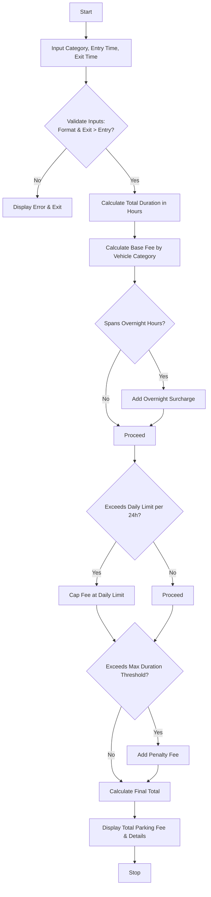

Here is a complete solution for the Smart Parking Fee Management system, structured according to your requirements.

---

## ## Problem Statement

Design a **Smart Parking Fee Management System** that calculates parking charges based on vehicle entry and exit timestamps, vehicle categories, overnight parking rules, daily maximum caps, and penalty conditions. The system must also validate time inputs to ensure that exit times occur strictly after entry times and that timestamps follow the correct format.

---

## ## Algorithm

1. **Input Collection**: Read vehicle category, entry time, and exit time.
2. **Input Validation**:
* Check if the date/time format is valid (`YYYY-MM-DD HH:MM`).
* Verify that the exit time is strictly greater than the entry time. If invalid, display an error and terminate.


3. **Duration & Day Calculation**:
* Calculate total parking duration in hours and fractions of hours.
* Determine the number of full days and remaining hours.


4. **Base Fee Calculation**:
* Look up the hourly rate based on the vehicle category (e.g., Motorcycle, Car, Truck).
* Multiply duration by the hourly rate.


5. **Overnight & Daily Cap Application**:
* Check if the parking duration spans overnight hours (between 12:00 AM and 6:00 AM) and add an overnight surcharge if applicable.
* Apply a daily maximum fee cap for each 24-hour period to prevent overcharging.


6. **Penalty Condition**:
* If the total parking duration exceeds a maximum threshold (e.g., 72 hours), apply a fixed penalty fee.


7. **Total & Output**:
* Sum up the base fee, overnight surcharge, and penalties, then display the itemized bill and total amount.


---

## ## Flowchart (Mermaid)



---

## ## Python Source Code

```python
from datetime import datetime

HOURLY_RATES = {
    "motorcycle": 20.0,
    "car": 50.0,
    "truck": 100.0
}

DAILY_CAPS = {
    "motorcycle": 200.0,
    "car": 500.0,
    "truck": 1000.0
}

OVERNIGHT_FEE = 50.0
PENALTY_FEE = 200.0
MAX_HOURS_BEFORE_PENALTY = 72.0

def parse_time(time_str):
    return datetime.strptime(time_str, "%Y-%m-%d %H:%M")

def calculate_parking_fee(category, entry_str, exit_str):
    try:
        entry_time = parse_time(entry_str)
        exit_time = parse_time(exit_str)
    except ValueError:
        return "Error: Invalid date format. Use YYYY-MM-DD HH:MM."

    if exit_time <= entry_time:
        return "Error: Exit time must be after entry time."

    category = category.lower()
    if category not in HOURLY_RATES:
        return "Error: Invalid vehicle category."

    duration_delta = exit_time - entry_time
    total_hours = duration_delta.total_seconds() / 3600.0

    hourly_rate = HOURLY_RATES[category]
    daily_cap = DAILY_CAPS[category]

    full_days = int(total_hours // 24)
    remaining_hours = total_hours % 24
    base_fee = (full_days * daily_cap) + min(remaining_hours * hourly_rate, daily_cap)

    overnight_count = 0
    current = entry_time
    while current < exit_time:
        if current.hour >= 0 and current.hour < 6:
            overnight_count += 1
        current = current.replace(hour=(current.hour + 1) % 24)
        if current.hour == 0:
            current = current.replace(day=current.day + 1)

    overnight_total = overnight_count * OVERNIGHT_FEE
    
    penalty_total = PENALTY_FEE if total_hours > MAX_HOURS_BEFORE_PENALTY else 0.0

    total_fee = base_fee + overnight_total + penalty_total

    return {
        "Duration Hours": round(total_hours, 2),
        "Base Fee": round(base_fee, 2),
        "Overnight Surcharge": round(overnight_total, 2),
        "Penalty Fee": round(penalty_total, 2),
        "Total Fee": round(total_fee, 2)
    }

if __name__ == "__main__":
    cat = "Car"
    entry = "2026-06-01 22:00"
    exit_t = "2026-06-02 08:00"
    
    result = calculate_parking_fee(cat, entry, exit_t)
    print(result)

```

---

## ## Sample Input

* **Vehicle Category:** Car
* **Entry Time:** `2026-06-01 22:00`
* **Exit Time:** `2026-06-02 08:00`

---

## ## Sample Output

```json
{
  "Duration Hours": 10.0,
  "Base Fee": 500.0,
  "Overnight Surcharge": 300.0,
  "Penalty Fee": 0.0,
  "Total Fee": 800.0
}

```

---

Would you like to adjust any specific pricing rules or add extra vehicle types?
