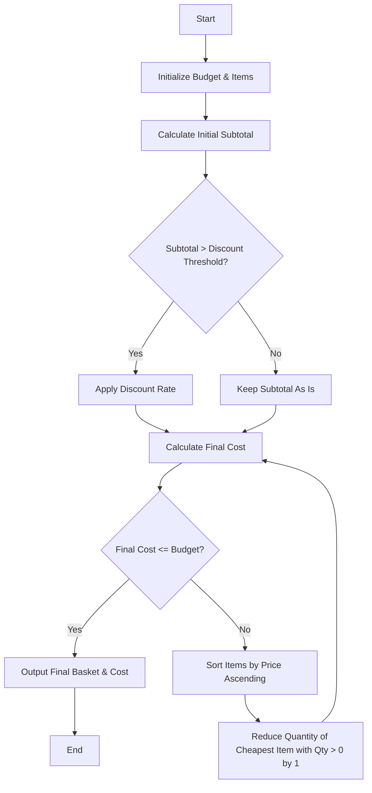

Here is a complete solution for the Multi-Product Shopping Budget Constraint problem, structured with the problem statement, algorithm, flowchart, and Python code.

---

## 1. Problem Statement

Given a list of products with unit prices and desired quantities, a store-wide discount threshold, a discount rate, and a fixed customer budget:

* Calculate the initial subtotal of the shopping basket.
* Apply a percentage discount if the subtotal exceeds the specified threshold.
* If the final discounted cost exceeds the user's budget, systematically reduce the quantities of items (starting from the lowest-priced items) until the total cost fits within or equals the budget.
* Output the adjusted shopping basket and the final total cost.

---

## 2. Algorithm

1. **Initialize** the budget, the list of items, the discount threshold, and the discount rate.
2. **Define a helper function** to compute the total cost:
* Sum up the cost of all items: $\sum (\text{price} \times \text{quantity})$.
* If the subtotal is greater than the discount threshold, apply the discount rate.


3. **Calculate** the initial total cost of the basket.
4. **Check Budget Constraint**:
* While the total cost is greater than the budget:
* Sort the items by price in ascending order (so cheaper items are reduced first).
* Find the first item with a quantity greater than $0$ and decrease its quantity by $1$.
* Recalculate the total cost.
* If all quantities reach $0$ and the budget is still exceeded, break the loop.


5. **Output** the final adjusted basket and the final cost.

---

## 3. Flowchart



---

## 4. Python Source Code

*(Written without comments as requested)*

```python
def evaluate_basket(budget, items, discount_threshold, discount_rate):
    basket = [item.copy() for item in items]
    
    def calculate_total(current_basket):
        subtotal = sum(item['price'] * item['quantity'] for item in current_basket)
        if subtotal > discount_threshold:
            return subtotal * (1 - discount_rate)
        return subtotal

    total_cost = calculate_total(basket)
    
    while total_cost > budget:
        basket.sort(key=lambda x: x['price'], reverse=False)
        reduced = False
        for item in basket:
            if item['quantity'] > 0:
                item['quantity'] -= 1
                reduced = True
                break
        if not reduced:
            break
        total_cost = calculate_total(basket)
        
    return basket, total_cost

budget = 500.0
items = [
    {'name': 'Laptop', 'price': 400.0, 'quantity': 1},
    {'name': 'Mouse', 'price': 50.0, 'quantity': 2},
    {'name': 'Keyboard', 'price': 100.0, 'quantity': 1}
]
discount_threshold = 400.0
discount_rate = 0.10

final_basket, final_cost = evaluate_based := evaluate_basket(budget, items, discount_threshold, discount_rate)
print("Final Basket:", final_basket)
print("Final Cost:", final_cost)

```

---

## 5. Sample Input

* **Budget:** $500.0
* **Discount Threshold:** $400.0 (10% discount applied if subtotal $> 400.0$)
* **Discount Rate:** $10\%$ ($0.10$)
* **Items:**
* Laptop: $400.0 \times 1$
* Mouse: $50.0 \times 2$
* Keyboard: $100.0 \times 1$


---

## 6. Sample Output

```text
Final Basket: [{'name': 'Laptop', 'price': 400.0, 'quantity': 1}, {'name': 'Mouse', 'price': 50.0, 'quantity': 1}, {'name': 'Keyboard', 'price': 100.0, 'quantity': 1}]
Final Cost: 495.0

```

> **Note:** The initial subtotal was $600.0$, which qualified for the $10\%$ discount bringing it to $540.0$. Since $540.0$ exceeded the $500.0$ budget, the algorithm reduced the quantity of the cheapest item (Mouse) from $2$ to $1$, resulting in a final discounted cost of $495.0$, successfully meeting the budget constraint!
