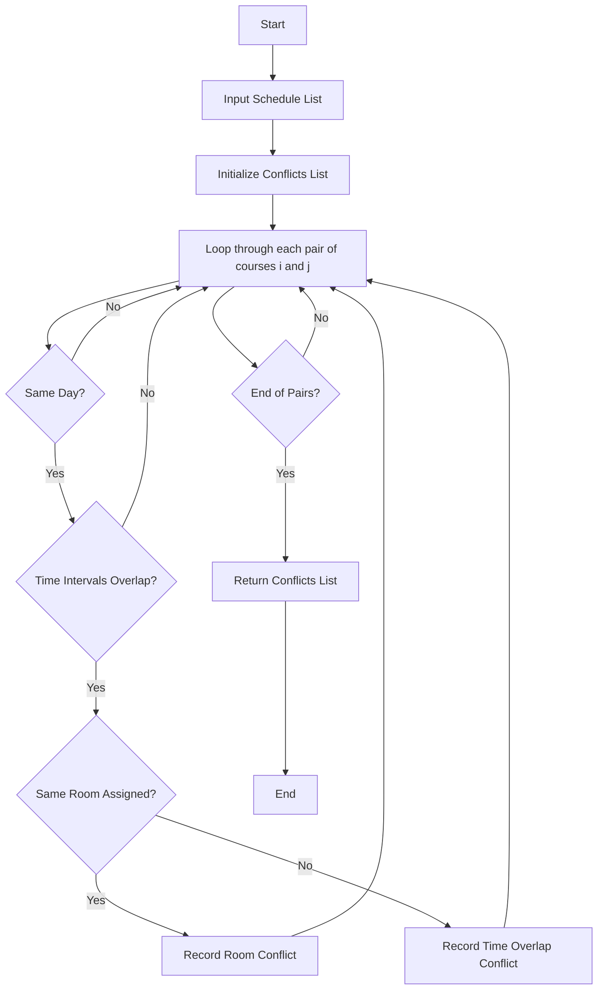

## Problem Statement

Develop a system to validate a proposed student timetable by analyzing a collection of scheduled courses. The system must:

* Represent course schedules using strings and tuples.
* Detect overlapping time periods for classes scheduled on the same day.
* Identify unavailable rooms where multiple courses are assigned to the same physical room simultaneously.
* Return a comprehensive list of timetable conflicts and validation results.

---

## Algorithm

1. **Initialize**: Define a function to check if two time intervals overlap: $\max(start_1, start_2) < \min(end_1, end_2)$.
2. **Iterate**: Compare every unique pair of scheduled courses in the timetable list.
3. **Check Day Match**: Verify if both courses occur on the same day.
4. **Check Time Overlap**: If they occur on the same day, check if their time intervals intersect.
5. **Check Room Conflict**: If their times overlap and they are assigned to the exact same room, log a room conflict.
6. **Record Conflicts**: Add any detected time overlaps or room conflicts to a results list.
7. **Output**: Return the list of conflicts, indicating whether the timetable is valid.

---

## Flowchart



---

## Python Source Code

```python
def check_time_overlap(start1, end1, start2, end2):
    return max(start1, start2) < min(end1, end2)

def validate_timetable(schedule):
    conflicts = []
    total_courses = len(schedule)
    
    for i in range(total_courses):
        for j in range(i + 1, total_courses):
            course1, day1, start1, end1, room1 = schedule[i]
            course2, day2, start2, end2, room2 = schedule[j]
            
            if day1 == day2:
                if check_time_overlap(start1, end1, start2, end2):
                    if room1 == room2:
                        conflicts.append(f"Room Conflict: '{room1}' is double-booked by {course1} and {course2} on {day1}.")
                    conflicts.append(f"Time Overlap: {course1} and {course2} overlap on {day1}.")
                    
    return conflicts

sample_schedule = [
    ("Mathematics", "Monday", 9, 11, "Room 101"),
    ("Physics", "Monday", 10, 12, "Room 102"),
    ("Chemistry", "Monday", 10, 12, "Room 101"),
    ("English", "Tuesday", 13, 15, "Room 103")
]

validation_results = validate_timetable(sample_schedule)
for conflict in validation_results:
    print(conflict)

```

---

## Sample Input

```python
[
    ("Mathematics", "Monday", 9, 11, "Room 101"),
    ("Physics", "Monday", 10, 12, "Room 102"),
    ("Chemistry", "Monday", 10, 12, "Room 101"),
    ("English", "Tuesday", 13, 15, "Room 103")
]

```

---

## Sample Output

```text
Room Conflict: 'Room 101' is double-booked by Mathematics and Chemistry on Monday.
Time Overlap: Mathematics and Chemistry overlap on Monday.
Time Overlap: Mathematics and Physics overlap on Monday.

```
