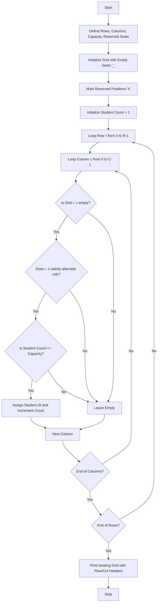

## Problem Statement

Design a Python program that generates an examination seating arrangement for a classroom using nested loops. The system must accept classroom dimensions (rows and columns), a maximum student capacity, a list of reserved or blocked positions (such as broken desks or pillars), and an alternate seating restriction (enforcing social distancing by skipping alternating seats). Finally, it must output a formatted grid with row and column identifiers.

---

## Algorithm

1. **Initialize Parameters:** Define classroom rows ($R$), columns ($C$), maximum capacity ($Cap$), and a list of reserved coordinate tuples.
2. **Create Grid:** Initialize a 2D matrix of size $R \times C$ filled with empty markers (`_`).
3. **Mark Reserved Seats:** Iterate through the reserved positions list and place a block marker (`X`) in the grid.
4. **Iterate and Allocate (Nested Loops):**
* Use an outer loop for rows (`r`) and an inner loop for columns (`c`).
* Check if the current position is available (not reserved and currently empty).
* Apply the alternate seating restriction (e.g., using a checkerboard pattern where `(r + c) % 2 == 0`).
* Assign sequential student IDs (e.g., `S01`, `S02`) while ensuring the total assigned count does not exceed the maximum capacity.


5. **Display Output:** Print the final grid accompanied by row (`R0`, `R1`...) and column (`C0`, `C1`...) headers.

---

## Flowchart



---

## Python Source Code

```python
def generate_seating(rows, cols, capacity, reserved):
    grid = [["_" for _ in range(cols)] for _ in range(rows)]
    
    for r, c in reserved:
        if 0 <= r < rows and 0 <= c < cols:
            grid[r][c] = "X"
    
    student_count = 1
    for r in range(rows):
        for c in range(cols):
            if grid[r][c] == "_":
                if (r + c) % 2 == 0:
                    if student_count <= capacity:
                        grid[r][c] = f"S{student_count:02d}"
                        student_count += 1
                        
    return grid

def print_grid(grid):
    cols = len(grid[0])
    print("     " + "   ".join([f"C{c}" for c in range(cols)]))
    print("-" * (6 + cols * 5))
    for r, row in enumerate(grid):
        print(f"R{r} | " + "  ".join(row))

rows = 4
cols = 4
capacity = 6
reserved = [(0, 1), (2, 2)]

seating_arrangement = generate_seating(rows, cols, capacity, reserved)
print_grid(seating_arrangement)

```

---

## Sample Input

* **Classroom Dimensions:** 4 Rows $\times$ 4 Columns
* **Maximum Capacity:** 6 Students
* **Reserved Positions:** `[(0, 1), (2, 2)]`
* **Alternate Rule:** Checkerboard pattern `(r + c) % 2 == 0`

---

## Sample Output

```text
       C0   C1   C2   C3
-------------------------
R0 |  S01   X    _    _
R1 |   _   S02   _   S03
R2 |   _    _    X   S04
R3 |  S05   _   S06   _

```
