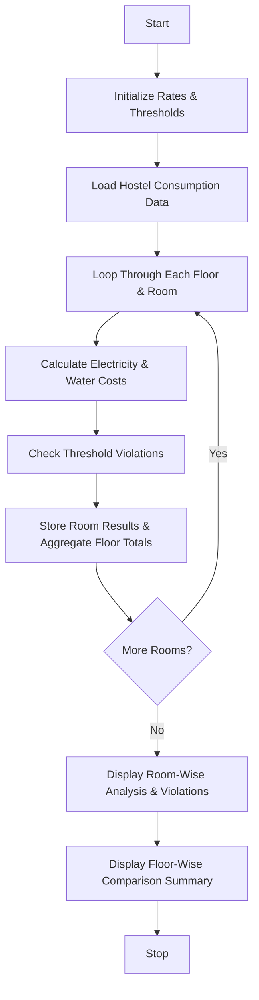

## Problem Statement

Develop a Python-based **Smart Hostel Resource Monitoring System** that analyzes room-wise electricity (in kWh) and water (in liters) consumption across multiple floors. The system must compute individual utility charges based on predefined unit rates, identify threshold violations when consumption exceeds specified limits, and aggregate resource utilization data to compare total consumption and costs across different floors.

---

## Algorithm

1. **Initialize Parameters:** Define unit rates for electricity and water, along with maximum permissible consumption thresholds per room.
2. **Define Data Structure:** Set up a nested dictionary storing consumption details (electricity and water) categorized by floor and room.
3. **Iterate & Calculate:** Traverse each floor and room to:
* Compute electricity charges (Electricity Consumption $\times$ Electricity Rate).
* Compute water charges (Water Consumption $\times$ Water Rate).
* Sum the charges to get the total room bill.


4. **Identify Violations:** Check if electricity or water consumption exceeds the defined thresholds. Flag any violations found.
5. **Aggregate Data:** Accumulate total resource consumption and costs for each floor.
6. **Display Output:** Output the room-wise breakdown with charges and violation statuses, followed by a floor-wise comparison summary.

---

## Flowchart



---

## Python Source Code

```python
def monitor_hostel_resources():
    elec_rate = 8.0
    water_rate = 0.05
    elec_threshold = 150.0
    water_threshold = 2000.0

    hostel_data = {
        "Floor 1": {
            "Room 101": {"electricity": 120.0, "water": 1800.0},
            "Room 102": {"electricity": 160.0, "water": 2200.0}
        },
        "Floor 2": {
            "Room 201": {"electricity": 140.0, "water": 1700.0},
            "Room 202": {"electricity": 155.0, "water": 2100.0}
        }
    }

    floor_summary = {}

    print("--- ROOM-WISE RESOURCE MONITORING & CHARGES ---")
    for floor, rooms in hostel_data.items():
        floor_elec = 0.0
        floor_water = 0.0
        floor_cost = 0.0
        print(f"\n{floor}:")
        for room, metrics in rooms.items():
            e_con = metrics["electricity"]
            w_con = metrics["water"]
            
            e_cost = e_con * elec_rate
            w_cost = w_con * water_rate
            total_cost = e_cost + w_cost
            
            floor_elec += e_con
            floor_water += w_con
            floor_cost += total_cost
            
            violations = []
            if e_con > elec_threshold:
                violations.append("Electricity Exceeded")
            if w_con > water_threshold:
                violations.append("Water Exceeded")
            
            status = ", ".join(violations) if violations else "Normal"
            
            print(f"  {room} -> Elec: {e_con} kWh, Water: {w_con} L | Total Charge: ₹{total_cost:.2f} | Status: {status}")
        
        floor_summary[floor] = {
            "electricity": floor_elec,
            "water": floor_water,
            "cost": floor_cost
        }

    print("\n--- FLOOR-WISE UTILIZATION COMPARISON ---")
    for floor, summary in floor_summary.items():
        print(f"{floor} -> Total Electricity: {summary['electricity']} kWh | Total Water: {summary['water']} L | Total Cost: ₹{summary['cost']:.2f}")

if __name__ == "__main__":
    monitor_hostel_resources()

```

---

## Sample Input

```json
{
  "Rates": {
    "Electricity Rate": "₹8.0 per kWh",
    "Water Rate": "₹0.05 per Liter",
    "Electricity Threshold": "150.0 kWh",
    "Water Threshold": "2000.0 Liters"
  },
  "Hostel Data": {
    "Floor 1": {
      "Room 101": {"electricity": 120.0, "water": 1800.0},
      "Room 102": {"electricity": 160.0, "water": 2200.0}
    },
    "Floor 2": {
      "Room 201": {"electricity": 140.0, "water": 1700.0},
      "Room 202": {"electricity": 155.0, "water": 2100.0}
    }
  }
}

```

---

## Sample Output

```text
--- ROOM-WISE RESOURCE MONITORING & CHARGES ---

Floor 1:
  Room 101 -> Elec: 120.0 kWh, Water: 1800.0 L | Total Charge: ₹1050.00 | Status: Normal
  Room 102 -> Elec: 160.0 kWh, Water: 2200.0 L | Total Charge: ₹1390.00 | Status: Electricity Exceeded, Water Exceeded

Floor 2:
  Room 201 -> Elec: 140.0 kWh, Water: 1700.0 L | Total Charge: ₹1205.00 | Status: Normal
  Room 202 -> Elec: 155.0 kWh, Water: 2100.0 L | Total Charge: ₹1345.00 | Status: Electricity Exceeded, Water Exceeded

--- FLOOR-WISE UTILIZATION COMPARISON ---
Floor 1 -> Total Electricity: 280.0 kWh | Total Water: 4000.0 L | Total Cost: ₹2440.00
Floor 2 -> Total Electricity: 295.0 kWh | Total Water: 3800.0 L | Total Cost: ₹2550.00

```
